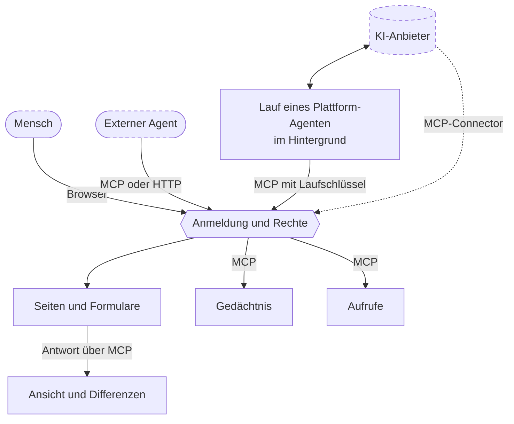
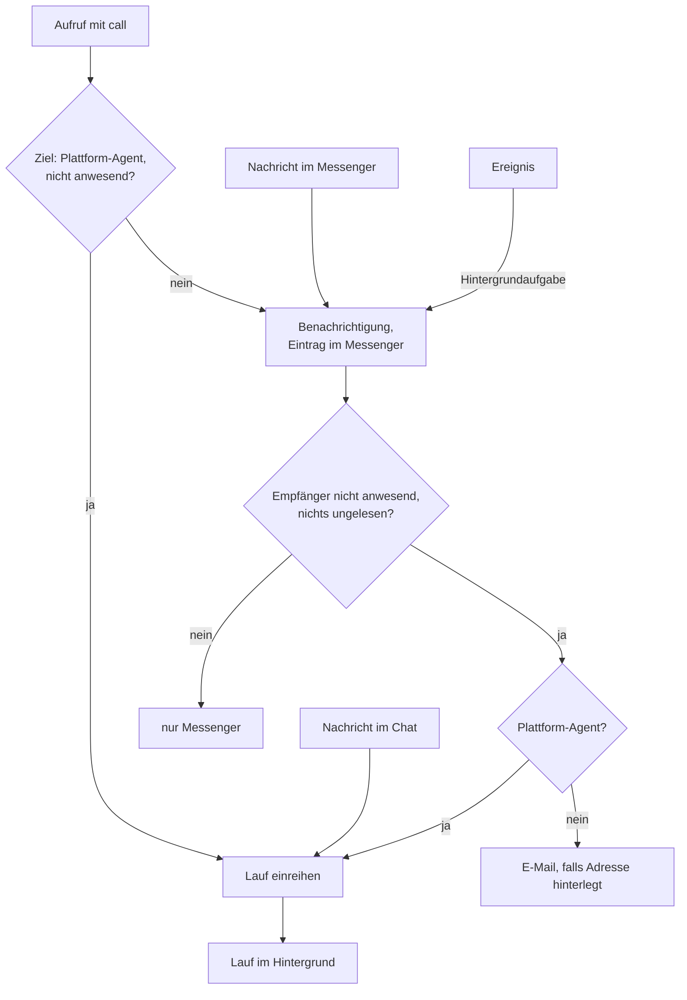
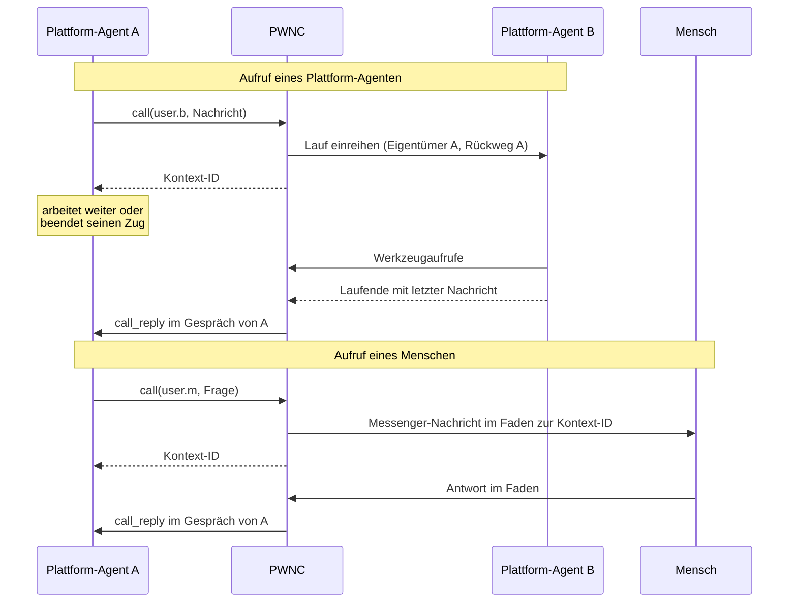
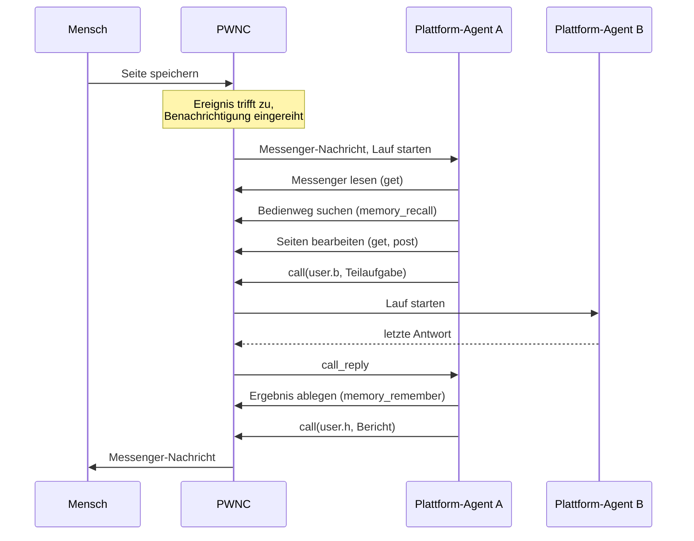

# Konzeptpapier: PWNC als Multiagentensystem

Stand: Release 26.10.23 (Version 26.10.23.1). Grundlage: Quellcode; für Abschnitt 6 zusätzlich eine Recherche zu anderen Systemen (Oktober 2026).

---

## Zusammenfassung

PWNC ist eine PHP-Plattform, die Website, Anwendungen, Desktop mit Messenger und Verwaltung in einer Installation bündelt. Dieses Papier beschreibt, wie KI-Agenten in die Plattform eingebunden sind und welche Abläufe dabei stattfinden.

Ein Agent ist ein Benutzerkonto. Er meldet sich mit einem Schlüssel an und bedient dieselben Seiten und Formulare wie ein Mensch; die Rechte des Kontos bestimmen, was er sieht und tun darf. Über das Model Context Protocol (MCP) stehen zwölf allgemeine Werkzeuge bereit: Seitenabruf und Formularversand, Nachlesen gespeicherter Antworten, Orientierung, ein gemeinsames Gedächtnis und Aufrufe anderer Konten. Seiten werden für Agenten gefiltert, wiederholte Abrufe als Differenz geliefert.

Konten mit hinterlegtem KI-Anbieter führt PWNC selbst aus (Plattform-Agenten). Ein Lauf beginnt durch den Chat, durch einen Aufruf oder durch eine Benachrichtigung, wird als Hintergrundaufgabe ausgeführt und schreibt jeden Schritt in ein Protokoll, aus dem das Gespräch rekonstruiert wird. Die Unterschiede zwischen Anbietern stehen in JSON-Templates. Hintergrundaufgaben werden durch Anfragen an die Plattform angestoßen; ein dauerhaft laufender Dienst ist nicht nötig.

Abschnitt 6 vergleicht die Mechanismen mit anderen Systemen und nennt, welche davon ohne direktes Vorbild sind.

---

## Inhalt

1. [Ausgangslage](#1-ausgangslage)
2. [Zielsetzung](#2-zielsetzung)
3. [Gesamtkonzept](#3-gesamtkonzept)
4. [Abläufe](#4-abläufe)
   1. [Identität und Anmeldung](#41-identität-und-anmeldung)
   2. [Zugang über MCP](#42-zugang-über-mcp)
   3. [Seitenabruf](#43-seitenabruf)
   4. [Gedächtnis](#44-gedächtnis)
   5. [Lauf eines Plattform-Agenten](#45-lauf-eines-plattform-agenten)
   6. [Aktivierung](#46-aktivierung)
   7. [Aufrufe](#47-aufrufe)
   8. [Chat und Messenger](#48-chat-und-messenger)
   9. [Hintergrundverarbeitung](#49-hintergrundverarbeitung)
   10. [Steuerung](#410-steuerung)
5. [Zusammenspiel](#5-zusammenspiel)
6. [Einordnung gegenüber anderen Systemen](#6-einordnung-gegenüber-anderen-systemen)
7. [Grenzen](#7-grenzen)
8. [Rahmenbedingungen und Abgrenzung](#8-rahmenbedingungen-und-abgrenzung)
9. [Offene Punkte](#9-offene-punkte)

---

## 1. Ausgangslage

PWNC ist als Plattform für Menschen entstanden: Seiten, Formulare, Rechte, Messenger. KI-Agenten sollen dieselben Arbeiten erledigen und mit Menschen und untereinander zusammenarbeiten. Dafür sind vier Fragen zu klären: Wie wird ein Agent erkannt und berechtigt, wie bedient er die Plattform, wie wird er aktiviert, und wie wird er kontrolliert.

Vier Umstände bestimmen die Antworten:

- **Funktionsumfang:** Die Plattform hat viele Anwendungen mit eigenen Abläufen. Eine Agentenschnittstelle je Funktion müsste bei jeder Änderung nachgezogen werden.
- **Umfang der Oberfläche:** Eine Webseite enthält mehr, als ein Agent zum Arbeiten braucht, und Agenten rufen dieselben Seiten wiederholt ab. Jedes übertragene Zeichen belegt Kontext und verursacht Kosten.
- **Kein Gedächtnis über ein Gespräch hinaus:** Ein Sprachmodell behält nichts zwischen Gesprächen. Ohne Ablage erkundet jeder Agent die Plattform in jedem Gespräch neu.
- **Betriebsumgebung:** PWNC läuft auf gewöhnlichem PHP-Webhosting, ohne dauerhaft laufende Prozesse und ohne Message-Broker.

---

## 2. Zielsetzung

Agenten nutzen dieselben Funktionen wie Menschen, ohne eigene Funktionsschnittstelle. Der Zugriff ist durch Rechte begrenzt, die Tätigkeit protokolliert und steuerbar.

Im Einzelnen:

1. Agenten und Menschen werden mit denselben Mitteln identifiziert, berechtigt und erreicht.
2. Agenten können jede Funktion nutzen, die ihre Rechte zulassen.
3. Was Agenten von der Oberfläche übertragen bekommen, ist gefiltert und bei Wiederholungen auf Änderungen beschränkt.
4. Erkenntnisse bleiben über Gespräche hinweg erhalten und lassen sich teilen.
5. Externe Agenten und Plattform-Agenten nutzen dieselbe Schnittstelle.
6. Der KI-Anbieter eines Agenten wird konfiguriert, nicht programmiert.
7. Agenten werden durch Menschen, durch andere Agenten und durch Vorgänge in der Plattform aktiviert.
8. Agenten geben Aufgaben an Agenten und Menschen weiter und erhalten Antworten.
9. Jeder Lauf ist begrenzt, unterbrechbar und protokolliert.
10. Der Betrieb braucht nur PHP, einen Webserver und die Datenbank.

---

## 3. Gesamtkonzept

**Agent als Benutzer.** Es gibt keinen eigenen Objekttyp für Agenten. Konto, Gruppen, Rechte und Messenger-Postfach sind die eines gewöhnlichen Benutzers. Agentenspezifisch sind der Schlüssel für die Anmeldung, ein Instruktionstext und bei Plattform-Agenten die Anbieterangaben.

**Oberfläche als Schnittstelle.** Agenten bedienen die Plattform über die vom Server erzeugten Seiten, Links und Formulare (HATEOAS). Was ein Agent tun kann, ergibt sich aus der ausgelieferten Seite und seinen Rechten. Es gibt keine Werkzeuge für einzelne Anwendungsfunktionen.

**Reduzierte Übertragung.** PWNC filtert Seiten für Agenten ohne Beteiligung eines Sprachmodells, überträgt wiederholte Abrufe als Differenz, kürzt lange Antworten und lässt sie gezielt nachlesen.

**Gemeinsames Gedächtnis.** Erkenntnisse werden in einer dauerhaften Ablage gespeichert, deren Regionen über Rechte geteilt werden. Agenten bewerten Einträge; wenig genutzte Einträge werden nach einer von der Bewertung abhängigen Frist gelöscht.

**Zwei Zugangswege.** Mit dem Schlüssel erreichen Agenten die Plattform direkt per HTTP oder über MCP. Filterung, Differenzen, Gedächtnis und Aufrufe gibt es nur über MCP. Plattform-Agenten nutzen immer MCP.

**Hintergrund ohne Dienst.** Läufe, Benachrichtigungen und Wartung sind Aufgaben in einer Dateiwarteschlange. Die Plattform startet einen Arbeitsprozess per HTTP-Anfrage an sich selbst, wenn Aufgaben anstehen.

### Bausteine und Zugangswege

Gestrichelt umrandet ist, was außerhalb von PWNC liegt. Wie Läufe ausgelöst werden, zeigt 4.6.

| Baustein | Aufgabe | Ort im Code (unter `pwnc/`) |
|---|---|---|
| Benutzerverwaltung | Konten, Gruppen, Rechte, Schlüssel, Instruktionen, Anbieterangaben | `#system/sys.permission.inc`, `module/#interface/ifc.permission.inc` |
| Anmeldung | Schlüssel, Laufschlüssel, Anwesenheit | `cms_identification()` in `pwnc.inc` |
| MCP-Zugang | Endpunkt, OAuth, Werkzeuge, Ansicht, Differenzen | `module/mcp.php`, `#system/sys.mcp.inc` |
| Gedächtnis | Regionen, Einträge, Suche, Bewertung, Bereinigung | `#system/lib.memory.inc` |
| Klassifikator | Stichwortvorschläge | `#system/lib.classifier.inc` |
| Laufmodell | Agentenschleife, Protokoll, eingebauter MCP-Client | `#system/lib.agent.inc`, `#system/lib.mcp_client.inc` |
| Anbieter-Templates | Anbieterprotokolle als Daten | `#json/agent/*.json` |
| Benachrichtigung | Zustellung an Menschen und Agenten | `notify()` in `#system/common/misc.inc` |
| Ereignisse | Bedingungen und Zeitpläne | `#system/sys.trigger.inc`, `module/#interface/ifc.trigger.inc` |
| Messenger | Nachrichten, Rückweg für Aufrufe | `module/#desktop/desktop.ims.inc` |
| Chat | Gespräche mit Plattform-Agenten | `module/#interface/ifc.agent.inc` |
| Hintergrund | Warteschlange, Arbeitsprozesse, Wartung | `cms_daemon()` in `pwnc.inc`, `module/daemon.php` |

---

## 4. Abläufe

### 4.1 Identität und Anmeldung

Ein Agent wird über ein gewöhnliches Konto geführt: Benutzername, Name, Notiz, Gruppen, Rechte, Zeitzone, Sprache. Die Notiz dient als Rollenbeschreibung. Name, Notiz und Gruppen werden dem Agenten beim Start genannt und sind für andere über das Werkzeug `whois` abrufbar; Rechte gibt `whois` nicht aus.

Agentenspezifisch sind am Konto der Instruktionstext, das Erinnerungsintervall für diesen Text und der Schlüssel mit Ablaufdatum, bei Plattform-Agenten zusätzlich Anbieter-Template, Endpunkt, Modell, Schlüssel des Anbieters und Optionen (`name=wert` je Zeile).

**Schlüssel.** Jedes Konto kann einen Schlüssel erhalten: 32 Zufallsbytes als 64 Hexadezimalzeichen. PWNC speichert nur den Hash und zeigt den Schlüssel einmal an. Ein neuer Schlüssel ersetzt den bisherigen. Ein Schlüssel trägt die Rechte seines Kontos; wer für eine Aufgabe weniger Rechte vergeben will, legt dafür ein eigenes Konto an.

**Anmeldung mit Schlüssel.** Eine Anfrage mit `Authorization: Bearer <Schlüssel>` wird dem Konto zugeordnet; Passwort und CSRF-Token entfallen. Für PWNC ist jede solche Anfrage eine Agentenanfrage. Abgewiesen werden unbekannte Schlüssel, gesperrte Konten und abgelaufene Schlüssel mit HTTP 401. Beim ersten Zugriff nach dem Ablaufdatum löscht PWNC alle Schlüssel des Kontos, auch die Laufschlüssel.

**OAuth.** Für MCP-Clients, die OAuth verlangen, bietet der MCP-Endpunkt Metadaten, dynamische Client-Registrierung und einen Autorisierungsablauf mit PKCE. Im Autorisierungsformular gibt der Benutzer den Schlüssel ein; das ausgegebene Zugriffstoken ist dieser Schlüssel. OAuth dient damit nur der Übergabe des Schlüssels an den Client.

**Plattform-Agent und externer Agent.** Ein Konto mit gewähltem Anbieter-Template ist ein Plattform-Agent: PWNC führt seine Läufe beim Anbieter aus. Ein Konto ohne Template, das mit Schlüssel zugreift, ist ein externer Agent; sein Modell läuft in einem Client außerhalb von PWNC.

**Laufschlüssel.** Jeder Lauf eines Plattform-Agenten erhält einen eigenen Schlüssel. Er ist mit einem geheimen Wert der Installation signiert und verweist auf Eigentümer, Agent und Gespräch. Anfragen mit diesem Schlüssel ordnet PWNC dem Gespräch zu. Am Ende des Laufs wird er gelöscht.

**Anwesenheit.** Jede Anfrage im Browser markiert das Konto für 15 Minuten als anwesend; Anfragen mit Schlüssel tun das nicht. Nutzt ein Mensch ein Agentenkonto im Browser, starten Aufrufe und Benachrichtigungen in dieser Zeit keinen Lauf, und Nachrichten bleiben im Messenger des Kontos. Der Chat startet Läufe unabhängig davon.

### 4.2 Zugang über MCP

**Endpunkt.** Der feste Endpunkt ist `pwnc/module/mcp.php`. PWNC unterstützt die MCP-Version 2026-07-28 in ihrer zustandslosen Form: Jede Anfrage trägt Methode, Version und Werkzeugname zusätzlich in HTTP-Headern, die mit dem Inhalt übereinstimmen müssen. Anfragen anderer Versionen werden abgewiesen. Jeder andere PHP-Endpunkt von PWNC nimmt MCP-Anfragen ebenfalls an; dann ist er selbst das Ziel.

**Ziel einer Anfrage.** Bei `get` und `post` über den festen Endpunkt bestimmt das Argument `url` das Ziel:

- Ein PHP-Skript innerhalb der Installation wird im selben Prozess ausgeführt, mit umgeschriebenem Anfragekontext und unter der Identität des Agenten.
- Jede andere Adresse wird über den eingebauten HTTP-Proxy abgerufen.
- Ohne `url` ist der Desktop das Ziel.

`post` übergibt die Formulardaten als `$_POST` und `$_FILES`. Dateien werden als Base64-Daten oder als Adresse übergeben, die PWNC abruft. Ein Objekt mit leerem Schlüssel wird zu einem mehrsprachigen Wert zusammengesetzt.

**Werkzeuge.** PWNC prüft die Argumente jedes Aufrufs gegen das Schema des Werkzeugs.

| Gruppe | Werkzeuge |
|---|---|
| Seitenzugriff | `get`, `post`, `get_response` |
| Orientierung | `readme_first`, `resources_list`, `resources_read`, `whois` |
| Gedächtnis | `memory_remember`, `memory_recall`, `memory_rate` |
| Kommunikation | `call`; `call_reply` ist nur der Umschlag für zugestellte Antworten und nicht aufrufbar |

**Plattformanleitung.** `readme_first` liefert in dieser Reihenfolge: Domain, Benutzername, Name und Notiz, Gruppen, bei Läufen die Kontext-ID, die Plattformanleitung (`pwnc/mcp/resources/README.md`), die Liste der Skills (`pwnc/mcp/resources/SKILLS/`), die Gedächtnisübersicht mit fälligen Wiedervorlagen und gegebenenfalls den Instruktionstext. Derselbe Text steht in der Antwort auf `server/discover` im Feld `instructions`.

**Instruktionen.** Plattform-Agenten erhalten den Instruktionstext einmal im Systemprompt jedes neuen Gesprächs. Für externe Agenten gilt das Erinnerungsintervall n des Kontos: Bei n > 0 steht der Text vor dem Ergebnis des ersten Werkzeugaufrufs nach `tools/list` und danach vor jedem n-ten Ergebnis, außerdem immer in `readme_first`. Bei n = 0 erhalten externe Agenten den Text nicht.

**Direkter HTTP-Zugang.** Mit dem Schlüssel im Header kann ein Agent jede Seite abrufen und jedes Formular absenden, für das er Rechte hat. Er erhält das ungefilterte HTML und keine Differenzen und hat keinen Zugang zu Gedächtnis und Aufrufen.

### 4.3 Seitenabruf

Ablauf bei `get` und `post`:

1. Die Zielseite wird erzeugt wie für einen Browser. PWNC fängt die Ausgabe ab und bereitet sie nach dem Seitenaufbau auf.
2. **Weiterleitung:** Setzt die Seite einen `Location`-Header, erhält der Agent nur „Redirects to: …“ mit der Zieladresse und ruft das Ziel selbst ab.
3. **Binärdaten** werden Base64-kodiert geliefert.
4. **Ansicht:** Für HTML gilt standardmäßig die Ansicht `llm`. Sie behält Struktur, Text, Formulare, Links, Bilder mit `alt` und den Inhalt von Skripten, weil Aktionen der Oberfläche teilweise über Skripte laufen. Sie entfernt Darstellungsattribute wie `class` und `style` sowie `style`- und `svg`-Elemente samt Inhalt. Elemente außerhalb der Filterliste verlieren ihr Tag und behalten den Inhalt; ihre Attribute `id`, `alt`, `data-*`, `aria-*` und `on*` erscheinen als JSON-Objekt. Die Oberfläche markiert Bereiche mit `data-agent-info`, etwa aktives Modul, aktive Aktion, Systemmeldung, Gefahrenbereich und zu ignorierende Felder; diese Markierungen bleiben erhalten. Die Ansicht `raw` liefert das unveränderte HTML.
5. **Zeilen:** Nach jedem Tag beginnt eine neue Zeile; das Zeichen `¬` kennzeichnet den eingefügten Umbruch. Die Zeilen werden nummeriert.
6. **Differenz:** PWNC speichert jede gelieferte Antwort je Konto, Ansicht und Adresse eine Stunde lang. Liegt für die Adresse eine Antwort vor, berechnet PWNC einen Unified Diff mit einer Zeile Kontext. Liegt keine vor, dient die zuletzt gelieferte Antwort einer beliebigen Adresse als Basis; das betrifft vor allem Formularversand und Weiterleitungsziele, deren Seite der vorigen ähnelt. Geliefert wird der Diff, wenn er kürzer ist als 90 % der vollständigen Antwort (höchstens 32 000 Byte) und nicht mehr Änderungen enthält, als die Seite Zeilen hat. Zusammenhängende gelöschte Zeilen werden zu „~~~ n lines removed ~~~“ zusammengefasst, wenn das kürzer ist. Die Suche nach dem Diff ist auf 20 Millisekunden begrenzt; danach wird ein gröberer Diff verwendet.
7. **Kürzung:** Eine vollständige Antwort über 32 000 Byte wird an einer Zeilengrenze gekürzt und mit einem Hinweis auf `get_response` versehen.
8. **Ergebnis:** Es enthält gegebenenfalls den Instruktionstext, die HTTP-Header der Seite und den Inhalt mit Adresse und Medientyp.

Die Anfrage durchläuft dabei alle Schritte einer gewöhnlichen Anfrage: Wartungsaufgaben werden eingereiht, der Hintergrund wird angestoßen (4.9), und am Ende werden die Ereignisse geprüft (4.6).

**Nachlesen.** `get_response` liefert die gespeicherte Antwort zur letzten oder zu einer angegebenen Adresse, ganz, als Zeilenbereich oder als Treffer eines Suchtexts mit drei Zeilen Kontext. Die Seite wird dabei nicht neu erzeugt. `resources_read` bietet dieselben Möglichkeiten für Ressourcen.

**Zurücksetzen.** `tools/list` löscht die gespeicherten Antworten des Kontos. Eine neue Sitzung beginnt dadurch mit vollständigen Seiten.

### 4.4 Gedächtnis

**Regionen.** Das Gedächtnis besteht aus Regionen: `user.{name}` für ein Konto und `scope.{kennung}` für ein Thema. Jede Region ist eine Datenbanktabelle mit Volltextindex und einem Index ihrer Stichworte. Eine Region entsteht beim ersten Schreiben.

**Einträge.** Ein Eintrag besteht aus Stichworten (höchstens 100 Zeichen je Stichwort, 500 insgesamt), einer Beschreibung (höchstens 500 Zeichen), dem Inhalt und optional einer Datei. Dazu speichert PWNC Ersteller, letzten Bearbeiter, die Zeitpunkte von Erstellung, Änderung und letztem Lesen, die Zahl der Lesezugriffe, eine Fälligkeit und die Bewertung. Zwei Kennzeichen schützen Einträge: `read_only` erlaubt Änderungen nur dem Ersteller und den Verwaltern der Region, `safe` schließt Löschen und Bereinigung aus.

**Rechte.** Das Recht `memory` gibt vollen Zugriff auf die eigene persönliche Region. Für alle anderen Regionen gelten `memory.{typ}.{kennung}.reader`, `.writer` und `.operator`. `operator` schließt Lesen und Schreiben ein, `writer` schließt Lesen nicht ein. `memory.operator` gilt für alle Regionen.

**Abruf in Stufen.** `memory_recall` liefert je nach Angaben:

1. ohne Angaben: die zugänglichen Regionen mit den eigenen Rechten und den zehn häufigsten Stichworten,
2. eine Region: bis zu 100 Stichworte mit Häufigkeit und die 20 Einträge mit dem höchsten Wert aus Bewertung und Aktualität der letzten Änderung,
3. eine Suche: Volltext über Stichworte (Gewicht 4), Beschreibung (Gewicht 2) und Inhalt (Gewicht 1); ohne Angabe einer Region nur in Regionen, deren Stichwortindex ein Suchwort enthält; Treffer unter 25 % des besten Werts entfallen,
4. einen Eintrag: den vollständigen Inhalt; eine Datei nur als Verweis `memory:{region}/{nummer}` zum Abruf mit `resources_read`.

Die Stufen 1 bis 3 enthalten Beschreibungen und Metadaten, keine Inhalte. Das Lesen eines Eintrags erhöht den Lesezähler, setzt den Lesezeitpunkt und löscht eine Fälligkeit.

**Schreiben.** `memory_remember` mit einer Region legt einen Eintrag an, mit Region und Nummer ändert es ihn. Nicht übergebene Felder bleiben erhalten, `false` leert ein Feld. Änderungen laufen in einer Datenbanktransaktion.

**Bewertung und Löschung.** `memory_rate` nimmt eine Bewertung von 1 (falsch oder überholt) bis 5 (wichtig und nützlich) entgegen; gespeichert wird der Durchschnitt, unbewertete Einträge zählen 3. Die Bewertung 0 löscht den Eintrag; das dürfen Ersteller und Verwalter, außer bei `safe`. Stündlich löscht der Hintergrund jeden Eintrag ohne `safe`, dessen letzte Änderung länger als 36 Tage × Bewertung und dessen letzter Lesezugriff länger als 18 Tage × Bewertung zurückliegen. Bei Bewertung 3 sind das 108 und 54 Tage, bei 1 sind es 36 und 18, bei 5 sind es 180 und 90.

**Wiedervorlage.** Ein Eintrag kann eine Fälligkeit tragen. Ab diesem Zeitpunkt steht seine Adresse unter „DUE FOLLOW-UPS“ am Anfang jeder Übersicht und Suche, bis der Eintrag gelesen wird.

**Stichwortvorschläge.** Ein Klassifikator auf Basis von Zeichen-Trigrammen lernt aus allen Einträgen, welche Texte zu welchen Stichworten gehören; er wird bei jedem Anlegen, Ändern und Löschen nachgeführt. Jede Nachricht an einen Plattform-Agenten erhält bis zu drei Stichworte, die der Klassifikator dem Text zuordnet und die in einer für den Agenten lesbaren Region vorkommen. Ob der Agent damit sucht, entscheidet er selbst; Inhalte werden nicht eingefügt.

**Zugang und Herkunft.** Das Gedächtnis ist nur über die MCP-Werkzeuge erreichbar; die Browser-Oberfläche hat keine Gedächtnisanwendung. Einträge schreiben Agenten und Menschen, die einen MCP-Client mit ihrem Schlüssel nutzen. Das System selbst legt nur die Antworten auf Aufrufe externer Agenten an (4.7).

### 4.5 Lauf eines Plattform-Agenten

Für Plattform-Agenten übernimmt PWNC die Rolle des Clients. Ein Gespräch besteht aus einem oder mehreren Läufen; ein Lauf ist eine Folge von Modellanfragen und Werkzeugausführungen, bis das Modell fertig ist oder eine Grenze erreicht ist.

**Gespräch und Eigentümer.** Ein Gespräch hat eine Kontext-ID aus Zeitstempel und Zufallsteil und einen Eigentümer. Eigentümer ist, wer das Gespräch begonnen hat: der Mensch im Chat, der Aufrufer oder bei Benachrichtigungen der Agent selbst. Das Protokoll liegt in `data/#agent/{eigentümer}/{agent}/{kontext-id}.json`.

**Protokoll.** Das Protokoll ist eine Datei mit einem JSON-Eintrag je Zeile, an die nur angehängt wird. Eintragsarten sind Systemprompt, Nachricht, Werkzeugergebnis, Anfrage, Antwort, Kompaktierung und Stopp. Jeder Eintrag trägt Zeit, seine Byte-Position als Index, Absender und Daten, Modellantworten zusätzlich Werkzeugaufrufe, Reasoning, den Tokenverbrauch der Anfrage und den kumulierten Verbrauch. Von Anfragen speichert der Lauf nur die Felder, die sich seit seiner vorigen Anfrage geändert haben, ohne die Nachrichtenliste; Antworten speichert er roh. Die stündliche Bereinigung entfernt Gespräche, deren Datei 30 Tage nicht geändert wurde.

**Start.** Eine Nachricht an ein bestehendes Gespräch wird sofort an das Protokoll angehängt; die erste Nachricht eines neuen Gesprächs schreibt der Lauf bei seinem Start. PWNC reiht den Lauf als Hintergrundaufgabe mit der Kennung `agent.run.{eigentümer}.{agent}.{kontext-id}` ein. Ist für das Gespräch bereits eine Aufgabe eingereiht oder aktiv, entsteht keine zweite; ein aktiver Lauf übernimmt neue Protokolleinträge vor jeder Modellanfrage.

**Vorbereitung.** Beim Start und erneut im Hintergrund lädt PWNC das Anbieter-Template des Kontos und führt die Optionen zusammen. Vorrang haben Startoptionen, dann Endpunkt, Modell und Schlüssel aus dem Konto, dann der Optionstext des Kontos, dann die Standardwerte des Templates. Fehlt eine Pflichtangabe, wird kein Lauf gestartet. Im Hintergrund erhält der Lauf dann seinen Laufschlüssel.

**Werkzeugweg.** Enthält das Template einen Abschnitt `server` (derzeit Anthropic) und ist die Option `internal` nicht gesetzt, übergibt PWNC dem Anbieter die eigene MCP-Adresse mit dem Laufschlüssel; der Anbieter führt die Werkzeuge während der Antwort selbst aus. Sonst fragt der eingebaute MCP-Client die Werkzeugliste über HTTP am eigenen Endpunkt ab und deklariert die Werkzeuge im Format des Anbieters; PWNC führt sie dann selbst aus.

**Rekonstruktion.** Der Lauf liest das Protokoll und baut daraus die Nachrichtenliste; Kompaktierungsmarken werden angewendet. Ist die Liste leer, holt er den Systemprompt über `readme_first` mit dem Laufschlüssel, also mit Kontext-ID und Instruktionstext, und schreibt Systemprompt und erste Nachricht ins Protokoll.

**Nachrichtenformat.** Schreibt ein anderes Konto, beginnt die Nachricht mit dessen Benutzernamen und Namen, bei Aufrufen gefolgt von „calls you“. Hinter einem Trennzeichen folgen der Seitenkontext aus dem Chat (4.8) und die Stichwortvorschläge (4.4); der Chat zeigt diesen Teil gesondert an.

**Schleife.** Ein Lauf stellt höchstens 32 Modellanfragen. Jede Runde:

1. Unterbrechungssignal prüfen.
2. Neue Protokolleinträge übernehmen, etwa Nachrichten, die während des Laufs eingegangen sind.
3. Anfrage senden (höchstens 300 Sekunden, Antwort höchstens 4 MB).
4. Meldet die Antwort einen Kontextüberlauf (Muster des Templates im Fehlertext oder im Stoppgrund), ersetzt der Lauf die ältesten Werkzeugergebnisse durch „~~~ compacted ~~~“, bis ein Viertel der Anfragegröße frei ist, protokolliert das und wiederholt die Anfrage. Die Wiederholung zählt nicht als Anfrage. Ist nichts mehr zu kompaktieren oder meldet dieselbe Anfrage nach drei Kompaktierungen noch einen Überlauf, endet der Lauf.
5. Enthält die Antwort einen Fehler, endet der Lauf mit diesem Fehler.
6. Der Stoppgrund wird über die Tabelle des Templates einer Aktion zugeordnet: `tool` (Werkzeuge ausführen, weiter), `stop` (Ende, sofern keine Werkzeugaufrufe offen sind), `resume` (nächste Anfrage ohne neue Eingabe). Ein Stoppgrund ohne Eintrag beendet den Lauf mit Fehler.
7. Die Antwort wird als Nachricht des Agenten gespeichert. Reasoning wird gesondert abgelegt und aus der Nachricht entfernt, wenn das Template keine Wiedergabe verlangt. Der Tokenverbrauch wird je Anfrage und kumuliert gespeichert.
8. Werkzeugaufrufe, die der Anbieter nicht selbst beantwortet hat, führt der eingebaute MCP-Client aus und speichert die Ergebnisse. Ist inzwischen ein Unterbrechungssignal gesetzt, erhalten die verbleibenden Aufrufe das Ergebnis „Interrupted.“, und der Lauf endet vor der nächsten Anfrage.

**Ende.** Der Lauf schreibt einen Stopp-Eintrag mit Grund und Fehlerkennzeichen. Trägt er einen Aufrufer, leitet er die letzte Textnachricht des Agenten an diesen weiter (4.7). Dann löscht er den Laufschlüssel. Ist ein Löschsignal gesetzt, löscht er stattdessen die Gesprächsdatei.

**Abbruch.** Endet der Prozess, bevor der Lauf einen Stoppgrund hat, setzt der Lauf später aus dem Protokoll fort. Nach einer abgefangenen Ausnahme schreibt er „Process was killed.“ und reiht sich erneut ein; nach dem fünften Abbruch endet er mit „Process was killed repeatedly.“. Nach einem fatalen Fehler, etwa dem Zeitlimit, oder wenn der Prozess beendet wird, bleibt seine Aufgabe in der Warteschlange und wird von einem späteren Arbeitsprozess erneut ausgeführt.

**Grenzen je Lauf.** 32 Modellanfragen, 300 Sekunden je Anfrage, 4 MB je Antwort. Die Startoptionen `limit` und `timeout` können die ersten beiden ändern; keiner der drei Startwege setzt sie, und der Optionstext des Kontos wirkt nicht auf sie.

**Anbieter-Templates.** Ein Template (`pwnc/#json/agent/*.json`) beschreibt einen Anbieter als Daten:

- Adresse, Header und Anfragekörper mit Platzhaltern wie `%model%`, `%message%` und `%tool%`; Felder in eckigen Klammern entfallen, wenn ihr Wert leer ist,
- die Form von Benutzer-, Assistenten-, System- und Werkzeugnachrichten sowie der Werkzeugdeklaration,
- die Pfade zu Antworttext, Reasoning, Werkzeugaufrufen, Fehlern, Stoppgrund und Tokenverbrauch,
- die Zuordnung von Stoppgründen zu Aktionen und ein Muster für Kontextüberläufe,
- Standardwerte, Pflichtangaben und Schalter, etwa ob Reasoning zurückgegeben wird oder ob der Cache in der Eingabe mitgezählt ist.

Templates liegen vor für Anthropic, OpenAI, Google (OpenAI-kompatibel), Microsoft (Azure OpenAI), OpenRouter und Poolside. Der Laufcode enthält keine anbieterspezifischen Verzweigungen. Ein Anbieter mit vergleichbarer JSON-Schnittstelle wird durch eine weitere Template-Datei angebunden.

### 4.6 Aktivierung

Plattform-Agenten werden auf drei Wegen aktiv:

| Weg | Auslöser | Eigentümer des Gesprächs | Voraussetzung | Rückmeldung |
|---|---|---|---|---|
| Chat | Nachricht im Chat | der Mensch | Recht `agent.{name}` oder Chat-Verwaltung | im Chat |
| Aufruf | Werkzeug `call` eines anderen Kontos | der Aufrufer | Recht `agent.{name}` beim Aufrufer, Agent nicht anwesend | letzte Antwort an den Aufrufer |
| Benachrichtigung | Messenger-Nachricht oder Ereignis | der Agent selbst | Agent nicht anwesend, keine ungelesene Benachrichtigung | keine automatische |

Der Weg vom Auslöser zum Lauf:

**Benachrichtigung.** Benachrichtigungen an Menschen und Agenten laufen über dieselbe Funktion:

1. Der Empfänger muss existieren und darf nicht gesperrt sein. Der Text wird auf 1500 Zeichen begrenzt.
2. Hat der Empfänger Desktop-Zugang, legt PWNC die Nachricht in seinem Messenger ab, bei Desktop-Zugang des Absenders auch eine Kopie bei diesem, und setzt eine Ungelesen-Markierung.
3. Eskaliert wird nur, wenn der Empfänger nicht anwesend ist und keine Ungelesen-Markierung aus einer früheren Benachrichtigung bestand.
4. Bei einem Plattform-Agenten startet die Eskalation ein neues Gespräch mit dem Agenten als Eigentümer. Die Nachricht ist der Hinweis „Neue Nachrichten“ mit der Adresse des Messengers; ohne Messenger-Zugang ist es der Text selbst.
5. Bei anderen Konten versendet sie eine E-Mail, wenn eine Adresse hinterlegt ist.

Ein so gestarteter Agent liest den Messenger selbst über `get`. Das Öffnen des Messengers löscht die Markierung; erst danach kann die nächste Benachrichtigung wieder einen Lauf starten.

**Ereignisse.** Ein Ereignis (Backend-Anwendung „Ereignisse“) hat einen Namen, Empfänger, einen Nachrichtentext mit den Platzhaltern `%name%`, `%application%`, `%url%`, `%time%` und `%user%`, Bedingungen und einen Zeitplan.

- **Bedingungen** gelten für die aktuelle Anfrage: Adresse, Anfrageparameter (`name=muster`), „Ausgabe enthält“ und „Ausgabe enthält nicht“ (Textausgaben bis 1 MB). Muster erlauben `*` als Platzhalter und `!` als Verneinung; PWNC übersetzt sie in reguläre Ausdrücke. Je Feld genügt eine zutreffende Zeile, gesetzte Felder müssen alle zutreffen.
- **Zeitpläne** bestehen aus Zeitpunkten (`2026-11-01 08:00`), Intervallen (`1d2h30m`) und Cron-Ausdrücken. Der nächste Fälligkeitszeitpunkt liegt je Ereignis in einer Datei, die beim Prüfen gesperrt wird, damit gleichzeitige Anfragen ein Ereignis nicht doppelt auslösen.
- **Prüfung:** Am Ende jeder Anfrage außerhalb des Arbeitsprozesses prüft PWNC alle aktiven Ereignisse, zuerst die Fälligkeit, sonst die Bedingungen. MCP-Werkzeuge außer `get` und `post` enden vor diesem Schritt.
- **Auslösung:** Je Auslösung entsteht eine Hintergrundaufgabe, die jedem Empfänger eine Benachrichtigung mit dem Absender „Ereignis“ (Konto `trigger`) schickt. Weil die Prüfung nach dem Anstoß des Hintergrunds stattfindet, wird diese Aufgabe erst mit einer späteren Anfrage ausgeführt (4.9).

Zeitpläne werden nur bei Anfragen geprüft; ein fälliges Ereignis wird mit der ersten Anfrage nach seinem Zeitpunkt ausgelöst. Weil auch die Seitenabrufe von Agenten geprüft werden, kann die Arbeit eines Agenten Ereignisse auslösen, die andere Agenten starten.

**Externe Agenten** sind über MCP nicht erreichbar, weil dort der Client fragt und PWNC antwortet. Benachrichtigungen erreichen ein externes Agentenkonto wie einen Menschen: im Messenger, den es selbst abrufen muss, oder per E-Mail. Antworten auf eigene Aufrufe findet es als Wiedervorlage im Gedächtnis.

### 4.7 Aufrufe

Ein Aufruf ist eine Nachricht an ein anderes Konto mit Rückweg für die Antwort. Das Werkzeug `call` erwartet ein Ziel (`user.{name}`), die Nachricht und optional eine Kontext-ID.

**Ablauf beim Aufrufer.**

1. PWNC prüft das Ziel: vorhandenes Konto, nicht das eigene.
2. Ist das Ziel ein Plattform-Agent und nicht anwesend, ist es ein Agentenaufruf; der Aufrufer braucht dafür `agent.{name}`. Sonst ist es ein Benutzeraufruf.
3. Kontext-ID: `false` beginnt einen neuen Austausch. Ohne Angabe übernimmt ein Plattform-Agent als Aufrufer seine eigene Kontext-ID; ein externer Aufrufer erhält eine neue. Eine angegebene ID setzt den Austausch mit dieser ID fort.
4. Das Werkzeug antwortet sofort mit der Kontext-ID; die Antwort des Ziels folgt später.

**Agentenaufruf.** PWNC beginnt oder setzt das Gespräch `{aufrufer}/{ziel}/{kontext-id}` fort und startet den Lauf des Ziels mit dem Aufrufer als Eigentümer und Rückweg. Endet der Lauf, geht seine letzte Textnachricht an den Aufrufer.

**Benutzeraufruf.** Die Nachricht ist auf 1500 Zeichen begrenzt. PWNC leitet aus der Kontext-ID einen Messenger-Faden ab und schickt eine Benachrichtigung (4.6). Wurde sie im Messenger zugestellt und hat der Aufrufer Desktop-Zugang, registriert PWNC einen Rückweg für diesen Faden. Jede Antwort des Empfängers in diesem Faden an den Aufrufer wird dann weitergeleitet. Ohne Rückweg ist die Nachricht eine Einbahnnachricht, und das Werkzeug teilt das mit.

**Zustellung der Antwort.**

- An einen Plattform-Agenten: PWNC schreibt einen erzeugten Aufruf `call_reply` und dessen Ergebnis in das Gespräch des Aufrufers, entweder „`ziel` (Name) answers your call: …“ oder, bei einem Fehler oder ohne Antworttext, „could not answer your call“ mit dem Stoppgrund. Ist für dieses Gespräch eine Aufgabe eingereiht oder aktiv, übernimmt sie die Einträge vor ihrer nächsten Modellanfrage; sonst wird ein neuer Lauf eingereiht.
- An einen externen Agenten: PWNC legt in dessen persönlicher Region einen Eintrag mit dem Stichwort `callback`, der Kontext-ID als Beschreibung und der Antwort als Inhalt an (ohne Antworttext: den Stoppgrund), sofort fällig. Der Agent sieht ihn bei seinem nächsten Gedächtnisabruf als Wiedervorlage.

**Regeln.**

- Ein Agentenaufruf liefert eine Antwort: die letzte Textnachricht beim Ende des gerufenen Laufs. Spätere Ergebnisse meldet der Gerufene mit einem eigenen Aufruf unter derselben Kontext-ID.
- Ein Lauf, der durch eine zugestellte Antwort neu beginnt, hat keinen Aufrufer. Sein Ergebnis erreicht einen früheren Aufrufer nur, wenn der Agent es mit `call` weitergibt.
- Läufe desselben Gesprächs laufen nacheinander. Der Aufrufer muss seinen Zug für die Antwort nicht beenden.
- Text, den der Aufrufer nach dem Aufruf schreibt, erreicht das Ziel nicht; das Ziel erreicht er nur über `call`.

### 4.8 Chat und Messenger

**Chat.** Der Chat ist die Backend-Anwendung „Agenten“ (`interface.agent`), die meist aus der Verwaltungsoberfläche in einem eigenen Fenster geöffnet wird. Verwalter des Chats haben zusätzlich das Recht `interface.agent.operator`.

- **Auswahl:** Ein Gespräch wird in drei Schritten gewählt:
  1. **Eigentümer**, also wessen Gespräche: Benutzer sehen nur ihre eigenen. Verwalter können jeden Eigentümer wählen, auch Agenten, die Gespräche mit anderen Agenten führen.
  2. **Agent:** Zur Wahl stehen die Plattform-Agenten, für die man das Recht `agent.{name}` hat. Verwalter sehen außerdem jeden Agenten, mit dem der gewählte Eigentümer Gespräche hat.
  3. **Gespräch:** eines der 100 jüngsten Gespräche mit diesem Agenten oder ein neues.
- **Senden:** Der Chat hängt den Seitenkontext des öffnenden Fensters an: dessen Adresse und versteckte Formularfelder, etwa Modul und gewähltes Objekt, ohne die als „ignore/omit“ markierten. Er sendet den Kontext nur, wenn er sich seit der letzten Nachricht geändert hat; ein Trennzeichen (U+E000) trennt ihn vom Text.
- **Anzeige:** Alle 5 Sekunden lädt der Chat neue Protokolleinträge: Systemprompt, Reasoning, Seitenkontext, Werkzeugaufrufe mit Ergebnis und Größe, Nachrichten mit dem Tokenverbrauch je Zug, Stoppgründe.
- **Eingriff:** Unterbrechen kann jeder, der das Gespräch sehen kann; löschen können nur Verwalter.

**Messenger.** Der Messenger ist Teil des Desktops (Recht `desktop`). Nachrichten haben Faden, Absender, Empfänger und Status; jedes Konto mit Desktop-Zugang kann jedem anderen schreiben. Agenten bedienen ihn über `get` und `post` wie Menschen. Antworten in Fäden mit registriertem Rückweg leitet PWNC an den Aufrufer weiter (4.7). Das Öffnen des Messengers löscht die Ungelesen-Markierung (4.6).

### 4.9 Hintergrundverarbeitung

**Warteschlange.** Eine Aufgabe ist eine PHP-Datei in `data/#daemon/`, erzeugt durch `cms_daemon(code, kennung, intervall)`. Eine Aufgabe mit derselben Kennung wird nicht erneut eingereiht, solange sie aussteht oder läuft. Wiederkehrende Aufgaben werden erst nach Ablauf ihres Intervalls seit der letzten Ausführung wieder eingereiht. Eine Markierungsdatei zeigt an, dass Arbeit ansteht.

**Start eines Arbeitsprozesses.** Jede Anfrage außerhalb des Arbeitsprozesses reiht am Ende der Initialisierung die fälligen Wartungsaufgaben ein und prüft dann die Markierung und einen freien Platz; dasselbe geschieht direkt nach dem Einreihen eines Laufs. Es gibt höchstens zwei Arbeitsprozesse. Ist beides gegeben, ruft PWNC `pwnc/module/daemon.php` per HTTP bei sich selbst auf und wartet höchstens eine Sekunde. Aufgaben, die eine Anfrage erst danach einreiht, etwa ausgelöste Ereignisse, startet die nächste Anfrage.

**Ausführung.** Der Arbeitsprozess sammelt alle ausstehenden Aufgaben und ordnet sie nach Einreihungszeit, einmalige Aufgaben zuerst. Jede Aufgabe wird vor der Ausführung gesperrt, sodass nur ein Prozess sie ausführt. Warten danach noch ungesperrte Aufgaben, startet er einen zweiten Arbeitsprozess. Jede Aufgabe hat ein PHP-Zeitlimit von 600 Sekunden; unter Linux zählt dabei die Rechenzeit, nicht das Warten auf Netzwerkantworten. Erledigte einmalige Aufgaben werden gelöscht, wiederkehrende geleert. Eine Statusdatei hält die letzten 25 Meldungen.

**Wartung.** Diese Aufgaben reiht jede Anfrage ein, sobald ihr Intervall abgelaufen ist:

| Aufgabe | Intervall |
|---|---|
| Cache-Bereinigung, einschließlich Agentengesprächen ohne Änderung seit 30 Tagen | 1 Stunde |
| Protokollpflege | 5 Minuten |
| Suchindex aktualisieren | 5 Minuten |
| Suchbewertung berechnen | 1 Stunde |
| Gedächtnisbereinigung | 1 Stunde |

MCP-Werkzeuge außer `get` und `post` enden vor diesem Schritt.

**Folge.** Ohne Anfragen an die Plattform laufen keine Hintergrundaufgaben, und keine Zeitpläne werden geprüft. Ein Cron-Job, der regelmäßig eine gewöhnliche Seite abruft, ersetzt fehlende Anfragen. Ein direkter Aufruf von `daemon.php` führt nur bereits eingereihte Aufgaben aus.

### 4.10 Steuerung

**Rechte.** Rechte sind hierarchische Bezeichner wie `interface.agent` oder `memory.scope.docs.reader`, die Konten und Gruppen gewährt oder entzogen werden. `*` und `operator` gelten für alle Unterebenen. Am Konto und in den Gruppen geht jeweils der Entzug der Gewährung vor; eine Festlegung am Konto geht den Gruppen vor. Rechte des anonymen Benutzers gelten für alle.

Agentenbezogen sind `agent.{name}` (Chat mit einem Plattform-Agenten und Aufruf), `interface.agent` und `interface.agent.operator` (Chat und Verwaltung aller Gespräche), die Gedächtnisrechte und `desktop` (Messenger). Alles andere regeln die Rechte der jeweiligen Anwendung. Ein Agent mit Verwaltungsrechten richtet Konten, Schlüssel und Ereignisse über die Oberfläche ein wie ein Mensch.

**Eingriff.** Unterbrechen setzt ein Signal, das der Lauf vor jeder Modellanfrage und vor jedem Werkzeugaufruf prüft; wartet der Lauf noch in der Warteschlange, wird die Aufgabe entfernt. Löschen während eines Laufs setzt zusätzlich ein Löschsignal; der Lauf löscht die Gesprächsdatei an seinem Ende.

**Nachvollziehbarkeit.** Das Protokoll enthält Systemprompt, Nachrichten, Anfragen ohne Nachrichtenliste, Rohantworten, Werkzeugergebnisse, Kompaktierungen und Stopps. Der Chat zeigt den Tokenverbrauch je Zug und insgesamt. Agenten wird ihr Verbrauch nicht mitgeteilt: Kennen sie ihre Grenzen, kürzen sie ihre Arbeit ab, und die Qualität sinkt. Zudem würde die Angabe selbst Tokens kosten und im Systemprompt den Prompt-Cache aufheben.

---

## 5. Zusammenspiel

Die Bausteine greifen an festen Stellen ineinander:

- **Eine Rechteprüfung.** Seiten, Gedächtnis, Aufrufe und Chat prüfen dieselben Rechte desselben Kontos. Für Agenten gibt es keinen Sonderweg.
- **Agentenanfragen sind Anfragen.** `get` und `post` durchlaufen den vollständigen Seitenaufbau einschließlich Ereignisprüfung und Hintergrundstart. Agenten lösen dieselben Ereignisse aus wie Menschen.
- **Ein Zustellweg.** Messenger-Nachrichten, Ereignisse und Aufrufe an Menschen laufen über dieselbe Benachrichtigung. Ob daraus ein Lauf oder eine E-Mail wird, entscheiden Kontotyp, Anwesenheit und Ungelesen-Markierung.
- **Das Protokoll ist der Zustand.** Jeder Lauf baut das Gespräch aus dem Protokoll neu auf. Fortsetzung nach Abbruch, Nachrichten während eines Laufs und zugestellte Antworten nutzen denselben Weg: einen Eintrag im Protokoll und einen eingereihten Lauf.
- **Ansicht und Gedächtnis.** Die Ansicht verringert die Datenmenge je Abruf, das Gedächtnis die Zahl der Abrufe für bereits bekannte Bedienwege.
- **Templates.** Der Laufcode liest nur Template-Felder; welcher Anbieter verwendet wird, ist eine Angabe am Konto.

Ein Ablauf über mehrere Bausteine:

---

## 6. Einordnung gegenüber anderen Systemen

Grundlage ist eine Recherche in Dokumentationen, Spezifikationen und Fachveröffentlichungen mit Stand vom 23. Oktober 2026. „Ohne direktes Vorbild“ heißt: Die Recherche fand kein System, das den Mechanismus in dieser Form umsetzt. Das schließt nicht aus, dass es eines gibt.

Die meisten Bausteine entsprechen Lösungen, die auch andere Systeme verwenden (6.1); Übereinstimmung heißt dabei nicht Übernahme. Drei weichen von diesen Lösungen in einem wesentlichen Punkt ab (6.2). Für neun Mechanismen fand die Recherche kein direktes Vorbild (6.3). Sie betreffen die Bedienung über die Oberfläche, den Austausch zwischen Agenten und Menschen, den Umgang mit dem Gedächtnis und den Betrieb ohne eigene Infrastruktur.

### 6.1 Gleiche Lösungen in anderen Systemen

| Mechanismus in PWNC | Vergleichbare Systeme |
|---|---|
| Agent als Benutzerdatensatz im Rechtesystem der Anwendung | ServiceNow: „AI user“ als Datensatz der Benutzertabelle [1]; Microsoft Entra Agent ID: Benutzerkonto als Untertyp, mit Postfach und Teams über Agent 365 [2] |
| Gedächtnis in Bereichen mit Zugriffsrechten | Google Memory Bank: IAM-Bedingungen je Scope [3]; Claude Managed Agents: Speicher je Sitzung lesend oder schreibend eingebunden [4]; Letta: von mehreren Agenten geteilte Blöcke [5] |
| Abruf in Stufen, Inhalte erst auf Anforderung | Anthropic Agent Skills: Beschreibungen zuerst, Inhalte bei Bedarf [6]; MemGPT: Speicherhierarchie, durch die das Modell blättert [7] |
| Löschen ungenutzter Erinnerungen | GitHub Copilot Memory: Löschung nach 28 Tagen ohne Nutzung [8]; MemoryBank: Vergessenskurve [9]; ExpeL: Bewertungen durch den Agenten, Löschung bei Zählerstand 0 [10] |
| Ersetzen alter Werkzeugergebnisse bei Kontextknappheit | Anthropic Context Editing [11] |
| Gesprächsprotokoll als Datei, Fortsetzung daraus | Claude Agent SDK: Sitzungen als JSONL [12]; LangGraph: Checkpointer [13] |
| Anbieterangaben als Konfiguration | LiteLLM: JSON-Einträge für OpenAI-kompatible Anbieter [14] |
| Werkzeugausführung beim Anbieter über MCP | Anthropic MCP-Connector [15]; OpenAI Responses API [16] |
| Differenzen statt vollständiger Beobachtungen | Playwright MCP: inkrementelle Snapshots seit Version 0.0.43 [17]; Studien zu Differenzverläufen [18][19] |
| Fortsetzbare Austausche über Kontext-IDs | A2A: `contextId` und `taskId` [20] |
| Hintergrundaufgaben über Anfragen an die eigene Installation | WordPress WP-Cron [21] |
| Start von Agenten durch Ereignisse und Zeitpläne | Microsoft Copilot Studio: Ereignis- und Wiederholungsauslöser [22] |
| Agentenläufe, die nach einer Unterbrechung fortsetzen | Cloudflare Agents: gespeicherte Zustände und Zwischenstände [23] |

### 6.2 Abweichungen

**Agent ohne Sonderstatus.** Bei Microsoft ist das Benutzerkonto eines Agenten ein Untertyp: ohne Passwort, ohne interaktive Anmeldung, an eine Agentenidentität gebunden und von privilegierten Administratorrollen ausgeschlossen [2]. ServiceNow kennzeichnet den Datensatz als „AI user“ [1]. PWNC kennt keinen Untertyp; ein Mensch kann dasselbe Konto im Browser nutzen, und ein Agent kann jedes Recht erhalten. Folge: Eine Rechteverwaltung gilt für alle Konten. Einschränkungen für Agenten entstehen nur über die vergebenen Rechte, nicht über den Kontotyp.

**Gedächtnisrechte aus dem Rechtesystem der Plattform.** Google regelt den Zugriff über IAM-Bedingungen seiner Cloud [3], Claude Managed Agents über die Einbindung je Sitzung [4], Letta über die Zuordnung von Blöcken zu Agenten [5]. In PWNC sind Gedächtnisrechte gewöhnliche Rechte der Plattform und gelten für jedes Konto, das über MCP zugreift; Regionen entstehen beim ersten Schreiben, und einzelne Einträge tragen eigene Schutzkennzeichen. Folge: Gedächtnis- und Anwendungsrechte werden an einer Stelle verwaltet. Eine Gedächtnisanwendung in der Browser-Oberfläche und eine Versionsgeschichte der Einträge wie bei Claude Managed Agents [4] gibt es nicht.

**Templates mit Ablaufsteuerung.** LiteLLM beschreibt OpenAI-kompatible Anbieter in JSON; komplexe Umwandlungen und Änderungen am Werkzeugaufruf verlangen Python-Code [14]. PWNC beschreibt im Template auch Werkzeugformate, die Zuordnung von Stoppgründen zu Aktionen und das Muster für Kontextüberläufe. Folge: Der Laufcode bleibt anbieterunabhängig. Was das Template-Schema nicht abbildet, erfordert eine Änderung des Laufcodes.

### 6.3 Ohne direktes Vorbild

**Gerenderte Oberfläche als vollständige Agentenschnittstelle.** Verbreitet sind ein Werkzeug je Funktion, etwa je Endpunkt bei FastAPI-MCP [24]; allgemeine Werkzeuge über ausdrücklich freigegebene Fähigkeiten, etwa die drei Werkzeuge des WordPress-MCP-Adapters [25]; Seiten, die eigene Werkzeuge veröffentlichen, bei WebMCP auch aus annotierten Formularen [26]; und Agenten, die die Oberfläche im Browser bedienen [17]. Hypermedia als Schnittstelle für Agenten wird in Forschung und Fachpresse vorgeschlagen [27][28]. PWNC setzt das auf dem Server um: `get` und `post` führen dieselben Links und Formulare aus wie für Menschen, im selben Prozess und unter der Identität des Agenten; die Ausgabe wird ohne Sprachmodell gefiltert. Die Recherche fand keinen MCP-Server, der die gesamte Oberfläche einer Anwendung so bereitstellt. Folgen: Neue Funktionen stehen Agenten ohne eigene Werkzeuge zur Verfügung. Jede Aktion kostet dafür Seitenabrufe; auf dem Testsystem WebArena erzielten Agenten mit API-Zugriff bessere Ergebnisse als reine Browser-Agenten und eine Kombination aus beidem die besten [29].

**Differenzen über Adressen hinweg.** Playwright MCP fasst unveränderte Teile des Barrierefreiheitsbaums zusammen [17]. Studien empfehlen Differenzen für den Beobachtungsverlauf von Web-Agenten [19] und zeigen, dass Differenzen Eingaben verlängern, wenn sich Beobachtungen stark ändern [18]. PWNC bildet Unified Diffs der gefilterten HTTP-Antwort beliebiger Adressen auf dem Server, greift nach Formularversand und Weiterleitung auf die Antwort einer anderen Adresse zurück und liefert einen Diff nur, wenn er kürzer als 90 % der vollständigen Antwort ist. Für den Rückgriff auf andere Adressen und diese Kombination fand die Recherche kein Vorbild.

**Ein Aufruf für Agenten und Menschen.** A2A verbindet Agenten untereinander [20]. In MCP kann der Server den Benutzer des verbundenen Clients befragen [30]. Twilio A2H stellt Agenten einen eigenen Kanal zu Menschen bereit [31], Magentic-UI bindet den Menschen in Planung und Ausführung ein [32]. In PWNC entscheidet sich erst beim Aufruf, ob er einen Lauf startet oder eine Messenger-Nachricht erzeugt, auch danach, ob ein Mensch das Agentenkonto gerade nutzt. Menschen antworten im gewöhnlichen Messenger; der Rückweg richtet sich nach der Art des Aufrufers. Für die Weiterleitung nach Anwesenheit fand die Recherche kein Vorbild.

**Gedächtnis als Rückkanal für zustandslose MCP-Clients.** Seit MCP 2026-07-28 antwortet ein Server nur auf Anfragen des Clients; Benachrichtigungen beschränken sich auf Listen- und Ressourcenänderungen über einen Kanal, den der Client offen hält, und lange Vorgänge fragt der Client über die Task-Erweiterung ab [30]. A2A stellt Antworten an einen Webhook des Clients zu [20]. PWNC legt Antworten auf Aufrufe externer Agenten als fällige Einträge in deren persönlichem Gedächtnis ab, wo sie bei jedem Abruf obenan stehen, bis sie gelesen sind. Kein direktes Vorbild gefunden. Folge: Eine Antwort erreicht den externen Agenten erst bei seinem nächsten Gedächtnisabruf.

**Lebensdauer abhängig von der Bewertung.** Einzelteile haben Vorbilder: ExpeL löscht Erkenntnisse nach Abwertungen durch den Agenten [10], GitHub Copilot löscht Erinnerungen nach 28 Tagen ohne Nutzung [8], MemoryBank folgt einer Vergessenskurve [9], Generative Agents gewichten Erinnerungen nach Wichtigkeit, ohne sie zu löschen [33]. In PWNC ist die durchschnittliche Bewertung aller Bewerter der Faktor zweier Fristen, seit der letzten Änderung und seit dem letzten Lesen; gelöscht wird erst, wenn beide abgelaufen sind. Für diese Regel fand die Recherche kein Vorbild.

**Stichworte statt Inhalte.** Verbreitet ist, Erinnerungsinhalte in den Kontext zu laden oder einen Index mitzugeben, etwa die Beschreibungen von Skills oder die Datei `MEMORY.md` in Claude Code [6][34]. PWNC ordnet jeder Nachricht an einen Plattform-Agenten bis zu drei Stichworte aus dem gemeinsamen Vokabular zu, nach Leserechten gefiltert, mit einem Klassifikator nach dem Verfahren der N-Gramm-Textkategorisierung [35]. Der Agent entscheidet, ob er damit sucht. Kein direktes Vorbild gefunden; die Recherche war in diesem Punkt weniger umfangreich als in den übrigen.

**Ereignisse auf der gerenderten Ausgabe.** Agentenplattformen starten Agenten über Ereignisse aus angebundenen Diensten und über Zeitpläne [22]. Regeln über Adresse, Parameter und Antwortinhalt einer Anfrage kennen Web Application Firewalls, dort zum Blockieren und Protokollieren [36]. PWNC prüft Bedingungen auf dem eigenen HTTP-Verkehr einschließlich der gerenderten Ausgabe, auch bei Abrufen durch Agenten, und startet damit Agenten. Kein Vorbild gefunden. Folge: Ketten aus Agenten entstehen ohne Orchestrierung; eine Begrenzung solcher Ketten gibt es nicht (7).

**Agentenläufe auf gewöhnlichem PHP-Hosting.** Hintergrundaufgaben über Anfragen an die eigene Installation sind in PHP verbreitet [21]. Agentenläufe, die Unterbrechungen überstehen, setzen sonst eigene Laufzeitumgebungen voraus, etwa Cloudflare Agents [23]. PWNC führt Agentenläufe mit dem PHP-Muster aus und setzt sie aus dem Protokoll fort. Kein dokumentiertes Vorbild gefunden. Folgen: Zusätzliche Infrastruktur ist nicht nötig. Parallelität, Laufzeit und Reaktionszeit hängen vom Verkehr und von den Grenzen des Hostings ab.

**Anweisungen durch den MCP-Server.** Das MCP-Feld `instructions` überträgt Anweisungen einmal mit der Beschreibung des Servers. Wiederholte Erinnerungen fügen sonst Clients ein, etwa Claude Code als Systemerinnerung neben Werkzeugergebnissen [37]. In PWNC fügt der Server den Instruktionstext des Kontos in jedes n-te Werkzeugergebnis ein. Kein Vorbild gefunden. Folge: Das wirkt mit jedem Client; nach der Instruktionshierarchie gewichten Modelle Text in Werkzeugergebnissen niedriger als Systemanweisungen [38].

### Quellen

1. ServiceNow: AI agent security implementation. https://www.servicenow.com/docs/r/intelligent-experiences/aia-security-implementation.html
2. Microsoft Learn: The agent's user account in Microsoft Entra Agent ID. https://learn.microsoft.com/en-us/entra/agent-id/agent-users
3. Google Cloud: Memory Bank, IAM conditions. https://docs.cloud.google.com/gemini-enterprise-agent-platform/scale/memory-bank/iam-conditions
4. Anthropic: Using agent memory (Managed Agents). https://platform.claude.com/docs/en/managed-agents/memory
5. Letta: Shared memory. https://docs.letta.com/guides/agents/multi-agent-shared-memory
6. Anthropic: Equipping agents for the real world with Agent Skills (2025). https://www.anthropic.com/engineering/equipping-agents-for-the-real-world-with-agent-skills
7. Packer u. a.: MemGPT: Towards LLMs as Operating Systems (2023). https://arxiv.org/abs/2310.08560
8. GitHub Docs: Copilot Memory. https://docs.github.com/en/copilot/concepts/agents/copilot-memory
9. Zhong u. a.: MemoryBank (2023). https://arxiv.org/abs/2305.10250
10. Zhao u. a.: ExpeL: LLM Agents Are Experiential Learners (2023). https://arxiv.org/abs/2308.10144
11. Anthropic: Context editing. https://platform.claude.com/docs/en/build-with-claude/context-editing
12. Anthropic: Work with sessions (Claude Agent SDK). https://code.claude.com/docs/en/agent-sdk/sessions
13. LangChain: LangGraph Persistence. https://docs.langchain.com/oss/python/langgraph/persistence
14. LiteLLM: Adding OpenAI-compatible providers. https://docs.litellm.ai/docs/contributing/adding_openai_compatible_providers
15. Anthropic: MCP connector. https://platform.claude.com/docs/en/agents-and-tools/mcp-connector
16. OpenAI: MCP servers. https://developers.openai.com/api/docs/guides/tools-remote-mcp
17. Microsoft: Playwright MCP, Release 0.0.43. https://github.com/microsoft/playwright-mcp/releases/tag/v0.0.43
18. Piterbarg, Pinto, Fergus: diff History for Neural Language Agents (2023). https://arxiv.org/abs/2312.07540
19. Enomoto u. a.: Read More, Think More: Revisiting Observation Reduction for Web Agents (2026). https://arxiv.org/abs/2604.01535
20. A2A Protocol Specification. https://a2a-protocol.org/latest/specification/
21. WordPress Plugin Handbook: Cron. https://developer.wordpress.org/plugins/cron/
22. Microsoft Learn: Event triggers overview (Copilot Studio). https://learn.microsoft.com/en-us/microsoft-copilot-studio/authoring-triggers-about
23. Cloudflare: Long-running agents. https://developers.cloudflare.com/agents/concepts/long-running-agents/
24. Tadata: FastAPI-MCP. https://github.com/tadata-org/fastapi_mcp
25. WordPress: MCP Adapter. https://github.com/WordPress/mcp-adapter
26. Chrome for Developers: WebMCP declarative API. https://developer.chrome.com/docs/ai/webmcp/declarative-api
27. Ciortea u. a.: A Decade in Hindsight: The Missing Bridge Between Multi-Agent Systems and the World Wide Web (AAMAS 2019). https://hal-emse.ccsd.cnrs.fr/emse-02070625
28. Wagner: HATEOAS: The API Design Style That Was Waiting for AI (Nordic APIs, 2025). https://nordicapis.com/hateoas-the-api-design-style-that-was-waiting-for-ai/
29. Song u. a.: Beyond Browsing: API-Based Web Agents (2024). https://arxiv.org/abs/2410.16464
30. Model Context Protocol, Specification 2026-07-28: Key Changes. https://modelcontextprotocol.io/specification/2026-07-28/changelog
31. Twilio: Introducing A2H (2026). https://www.twilio.com/en-us/blog/products/introducing-a2h-agent-to-human-communication-protocol
32. Mozannar u. a.: Magentic-UI: Towards Human-in-the-loop Agentic Systems (2025). https://arxiv.org/abs/2507.22358
33. Park u. a.: Generative Agents: Interactive Simulacra of Human Behavior (2023). https://arxiv.org/abs/2304.03442
34. Anthropic: How Claude remembers your project (Claude Code). https://code.claude.com/docs/en/memory
35. Cavnar, Trenkle: N-Gram-Based Text Categorization (1994). https://www.let.rug.nl/vannoord/TextCat/textcat.pdf
36. OWASP ModSecurity: Reference Manual (v3.x). <https://github.com/owasp-modsecurity/ModSecurity/wiki/Reference-Manual-(v3.x)>
37. Anthropic: Hooks reference (Claude Code). https://code.claude.com/docs/en/hooks
38. Wallace u. a.: The Instruction Hierarchy (2024). https://arxiv.org/abs/2404.13208

---

## 7. Grenzen

- **Protokollgröße.** Jeder Lauf liest das ganze Protokoll. Kompaktiert werden nur Werkzeugergebnisse; reicht das nicht, endet der Lauf an der Kontextgrenze.
- **Parallelität.** Es gibt höchstens zwei Arbeitsprozesse. Ein Lauf belegt einen davon für seine ganze Dauer; weitere Aufgaben warten.
- **Zeitlimit.** Jede Aufgabe hat 600 Sekunden PHP-Zeit, dazu kommen die Limits des Webservers. Ein abgebrochener Lauf setzt in einer späteren Runde fort.
- **Feste Laufgrenzen.** 32 Anfragen, 300 Sekunden je Anfrage und 4 MB je Antwort gelten für alle Konten.
- **Abhängigkeit von Anfragen.** Zeitpläne und Hintergrundaufgaben laufen nur, wenn die Plattform Anfragen erhält, durch Benutzer oder durch einen Cron-Job, der eine gewöhnliche Seite abruft.
- **Keine Begrenzung von Ereignisketten.** Löst die Arbeit eines Agenten ein Ereignis aus, das einen Agenten benachrichtigt, startet daraus ein neuer Lauf, sobald der Empfänger den Messenger seit der letzten Benachrichtigung geöffnet hat. Eine Zähl- oder Zeitgrenze für solche Ketten gibt es nicht.
- **Keine Aktivierung externer Agenten.** Externe Agenten müssen Messenger oder Gedächtnis selbst abfragen.
- **Eine Antwort je Aufruf.** Ketten über mehrere Agenten brauchen ausdrückliche Rückmeldungen mit `call`.
- **Benutzeraufrufe** sind auf 1500 Zeichen begrenzt und haben nur über den Messenger einen Rückweg.

---

## 8. Rahmenbedingungen und Abgrenzung

- PHP, ein Webserver und MySQL oder MariaDB. Gedächtnis und Klassifikator nutzen die Datenbank; bei MySQL ab 5.7.6 verwendet der Volltextindex den N-Gramm-Parser.
- Hintergrundaufgaben und Zeitpläne werden durch Anfragen an die Plattform angestoßen; ohne Verkehr übernimmt das ein Cron-Job, der eine gewöhnliche Seite abruft.
- Die Installation muss sich selbst per HTTP erreichen können, für den Arbeitsprozess und den eingebauten MCP-Client.
- Plattform-Agenten brauchen Zugang zu einem KI-Anbieter. Führt der Anbieter die Werkzeuge aus (Anthropic), muss PWNC für ihn aus dem Internet erreichbar sein.
- Externe MCP-Clients müssen die Version 2026-07-28 sprechen; Clients älterer Versionen brauchen eine Brücke außerhalb von PWNC. Ohne MCP bleibt der HTTP-Zugang mit Schlüssel.

**Abgrenzung.** Keine Werkzeuge für einzelne Anwendungsfunktionen. Keine Orchestrierungskomponente; Abläufe entstehen aus Aufrufen, Ereignissen und dem Gedächtnis. Keine Aktivierung externer Agenten. Keine Unterstützung älterer MCP-Versionen.

---

## 9. Offene Punkte

- **Tokenbegrenzung:** Eine Begrenzung des Tokenverbrauchs je Lauf ist vorgesehen, vor allem für Läufe aus Ereignissen und Aufrufen. Ort und Form der Konfiguration sind offen.
- **Laufgrenzen je Konto:** Anfrage- und Zeitgrenzen sind fest; der Optionstext des Kontos wirkt nicht auf sie. Ob sie je Konto einstellbar sein sollen, ist offen.